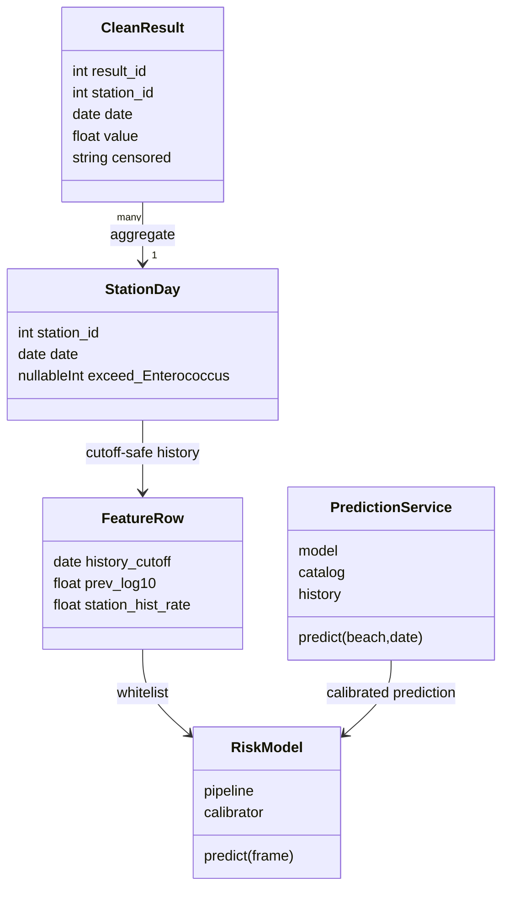
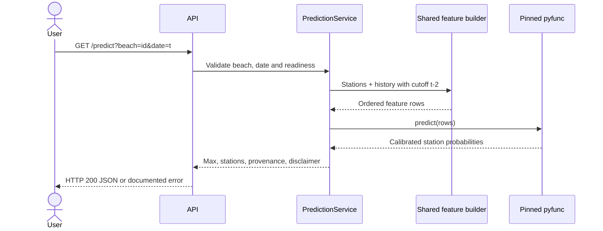
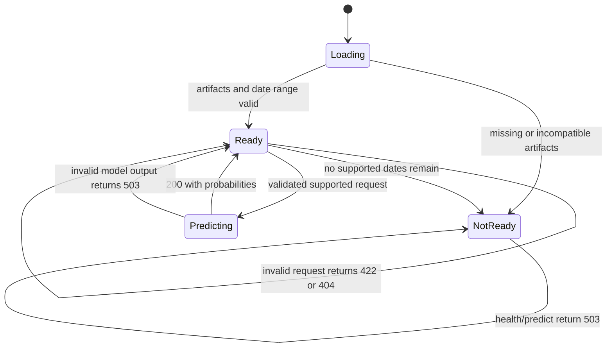

# Project update: implementation status and submission source material

Status date: 2026-11-19. This is a working checklist, not the final four-page PDF.
Source: `Project_update_rubric_dsc200_fa26.pdf`. Submit one concise PDF plus a code
ZIP/GitHub link with the required access. Do not submit all eight lengthy specs
as the rubric's four-page document.

## Recorded local verification

- `ruff check .` and `ruff format --check .`: passed.
- `pytest -q --cov=src`: **38 passed**, source coverage **83%** (4.33 s for this local run).
- Space uploader: offline tests verify package contents, token/repo configuration
  and Docker SDK checks. A live Hub upload has not been executed.
- `bash scripts/smoke.sh`: passed from a new temporary synthetic-data root,
  including the three baseline runs, model runs, export and an API request.
- Four implemented feature ablations were also executed successfully in the local demo experiment.
- Docker build and mounted-artifact API smoke: passed on this Mac's Linux/arm64
  engine with UID `user` (1000). Image about 1.05 GB; one observed memory sample
  was about 197 MiB (not a measured peak).
- Final local-container benchmark: 20 sequential requests, p95 **0.014 s**;
  50 requests with 10 concurrent workers, p95 **0.236 s**; no failed requests.
  This is a two-station synthetic request, not a full-data or hosted-Space benchmark.
- Working-tree data/size guard and CI YAML checks: passed. The first hosted run
  stopped before tests because Ubuntu 26.04 lacked the pinned Python 3.13.12 x64
  build. The workflow now pins Ubuntu 24.04 and uses current Actions versions.
  The repository Actions page/badge shows the current hosted result, independently
  of the local verification above.

The suite passes with third-party deprecation warnings from the installed web,
MLflow and pandas integrations. Real-data accuracy, the full LightGBM workflow
and a published Space remain unverified.

## Introduction and scope

Predict station-level Enterococcus exceedance of the team's single-sample limit
(104/100 mL), using only history available under a two-day laboratory delay. Serve
the station probabilities and their maximum for a requested beach/date. This is
an informational prediction, not an official advisory or a guarantee of safety.

Current scope: typed CSV cleaning, common station-day/label definitions,
descriptive EDA, historical/calendar/location features, chronological evaluation,
three baselines, an initial calibrated logistic model, local MLflow/export,
FastAPI and local Docker/CI scaffolding. Current demonstration uses synthetic data;
there are **no real-data model results** in this implementation check-in.

Out of scope for this check-in: official advisory decisions, daily labels on
unsampled days, external rainfall/tides, live ingestion, full experiment matrix,
Hub model publication/download, automatic Space deployment on push, scheduled
refresh/retraining and authentication. Manual Space source upload is available;
hosted prediction readiness still requires model/history artifact deployment.

Work distribution to confirm before submission: Shumeng owns specs 03 (features)
and 06 (API). The team should insert the agreed owners for 01–02, 04–05 and 07–08;
spec authors and code contributors are not assumed to be the same. This initial
scaffold connects all components so each owner can improve their module separately.

## Requirements selected for grading

| ID / priority | Requirement and verification | Trace |
|---|---|---|
| FR1 / Must | Convert the configured CSV to typed lab results, preserve censoring bounds, aggregate unique station-days and produce a feature parquet/report. Dropped-row counts reconcile. | Specs 01–03; `test_censoring_and_reconciliation`, feature tests |
| FR2 / Must | Fit baselines and a calibrated classifier on the chronological split, log local MLflow runs, and register a production champion only when the validation gain gate passes. | Specs 04–05; split/selection tests and offline smoke |
| FR3 / Must | Given a known beach ID and supported ISO date, return finite station probabilities, maximum station probability, model/snapshot provenance and disclaimer; malformed/unknown/unready cases return documented errors. | Spec 06; API functional tests |
| NFR1 / Must | A feature for t uses only same-station samples dated ≤t−2. Changing later labels/values must leave that row's features unchanged. | Spec 03; five-event and mutation tests |
| NFR2 / Must | Unit/integration tests and a fresh demo run without real datasets, production credentials or network data. Generated artifacts stay outside Git and fitted preprocessing is reused at inference. | Specs 05–08; network guard, temp MLflow/export and parity tests |
| NFR3 / Should | Warm single-beach API p95 <1 s locally; `/health` <100 ms, ≤2 GB peak memory/worker. | Specs 06–07; container/benchmark verification still needs recorded resource measurements |

## Data models and storage

- Raw: immutable public CSV. The downloader can obtain the full official resource
  or an explicitly labeled first-row API preview; the preview is not representative.
- Clean: `results_clean.parquet`, one lab result per unique `result_id`. Typed
  station/beach IDs, date, location, analyte, nonnegative reported value, units,
  censoring flag and audit fields. Invalid rows have counted reasons.
- Station-day: Enterococcus only, unique `(station_id,date)`, selected worst
  reported boundary and nullable target using specs 02–03. Unknown is not negative.
- Features: same keys, 18 whitelisted predictors (county/coordinates plus calendar,
  lag and history fields), nullable target, history cutoff and provenance. Parquet
  retains nullable types; model input normalization is shared by training and API.
- Model/snapshot: local MLflow pyfunc (preprocessing + classifier + calibrator),
  registry tags, matching feature-report hash, catalog and complete station history.
  Strict JSON, manifests and hashes identify the exported snapshot. Data, reports,
  databases and models are ignored by Git; source/tests/specs remain versioned.

Assumptions: fixed station locations must be known at prediction time; conflicting
metadata is rejected. Calendar delay approximates release availability. CFU/MPN
are pooled under the current spec, while molecular Copies units are excluded.
The `above_QL=104` and worst-boundary rules remain team decisions to revisit; the
implementation does not quietly change them. Missing dates are not labeled safe.

## Three UML diagram types

### 1. Class diagram — data contracts and serving objects

Why this type: makes row grain, responsibilities and model boundary explicit.

### 2. Sequence diagram — one prediction request

Why this type: shows that requests reuse the loaded model and common features;
they do not retrain or contact the raw Data API.

### 3. State diagram — readiness and failure behavior

Why this type: documents readiness separately from a successful process start and
prevents a dummy probability when required artifacts are absent.

## Test cases selected for grading

All cases run in `pytest`; no real CSV or external tracking server is a precondition.

| ID / type | Preconditions | Input / steps | Expected result / postcondition |
|---|---|---|---|
| U1 / unit | Tiny raw rows with required schema | Supply `<10`, `>24196`, negative, 1900 date, qPCR unit; call cleaner | Boundaries 10/24196 retained with censoring flags; invalid rows counted; rows-in minus drops equals rows-out |
| U2 / unit | One station on Jan 1,3,5,6,7, values 10,100,1000,10000,100000 | Build Jan 7 features; mutate Jan 6/7 results and repeat | Last eligible log=3, roll mean=2, history rate=1/3, age=2; unchanged after future mutation |
| U3 / unit | Fake validation metrics/baseline scores | Compare logreg .70, lgbm .705, baseline .60 then .69 | Tie selects logreg; first clears .02 gain, second registers nothing |
| F1 / functional | Empty temporary root, installed pinned dependencies | Generate synthetic CSV; clean, build features, run baselines/training, export, request API | Three spec-04 baseline runs, spec-05 runs, valid local demo model/snapshot, health/predict 200; no production champion |
| F2 / functional | Verified local demo export | Request valid beach/date, unknown beach, invalid date, too-early date | Valid prediction matches direct pyfunc to 1e-9; errors are 404/422 with stable envelope; no file mutation |
| F3 / functional | Same export but required feature report absent | Start app; request health and predict | Both return 503; no probability or substitute model |

Additional tests cover unknown censoring outcomes, station isolation, missing
history, train-only fallback rates, unseen categories, signature/hash failures
and artifact tampering. Exact latest test counts belong in the check-in notes
after executing the suite; don't copy a stale CI badge as evidence.

## Progress against the eight specs

| Spec | Working now | Still in progress |
|---|---|---|
| 01 | Typed cleaning, qualifier/boundary rules, validations, deterministic IDs, report, real CSV entry point | Full official-file run and performance measurement |
| 02 | Nine tables, six plot files and JSON on the synthetic fixture | Real-data interpretation; polish figure layout to all spec details |
| 03 | Shared cutoff-aware features, complete expanding counts, batch/inference parity | Larger-file benchmarks and team resolution of open target/resample choices |
| 04 | Three baselines, chronological split, metrics, grouped CSVs, local MLflow | Complete PR/calibration plot set and detailed final-run breakdown artifacts |
| 05 | Logistic grid, forward cross-fit sigmoid calibration, threshold/gate, pyfunc registration, four feature ablations | Full 30-trial/early-stopping LightGBM, remaining ablations, plots, complete subgroup/model-card analysis |
| 06 | Health/predict, pinned model, feature hash/signature checks, date bounds, errors, demo annotation | Broader acceptance fixtures and production snapshot integration |
| 07 | Verified local export and manifest, CLI smoke, non-root Dockerfile, manual Space source upload workflow | Hub model upload/download, hosted readiness, revision-pinned refresh/rollback, full hosted load/resource checks |
| 08 | Lint/test/smoke/data-guard workflow and same local commands | Actual hosted Actions run after pushing and branch-protection setup |

Implementation notes: use spec 03 canonical names throughout, with all cleaned
station-days retained; spec 04's older aliases/routine-only wording need team
alignment. The local tracker uses SQLite because installed MLflow 3.18 disables
the legacy file store by default. Spec 07's old joblib-only/no-MLflow serving
assumption is superseded by the spec 05–06 pyfunc contract. Demo registration has
its own model name and alias; production gating remains strict.

## Reflection — team member writes this section

Leave this section for the required personal 1–2 paragraphs. The rubric requests
that this reflection not be AI-generated. Describe your own actual experience,
challenges and learning after reading/running the code. Do not submit an invented
reflection or claim real-data/model/hosting results that have not been obtained.
